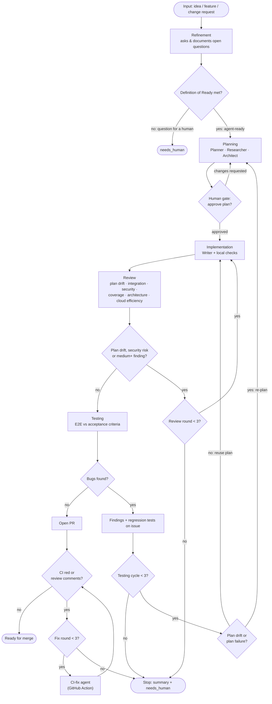

# SDLC pipeline

How an idea becomes a merged PR with one human gate: the maintainer approves the implementation plan, and
everything after that runs unattended. Refinement and the implementation agent's rules live in
[`issue-refinement.md`](issue-refinement.md); this file covers the stages around them, the loops, and the stop
conditions.

## Flow

## Stages

| # | Stage          | Agents                                  | Output                                    | Exit                                               |
| - | -------------- | --------------------------------------- | ----------------------------------------- | -------------------------------------------------- |
| 1 | Input          | maintainer                              | issue                                     | labelled `needs_refinement`                        |
| 2 | Refinement     | Refiner                                 | refined issue                             | `agent-ready`, or `needs_human` with the question  |
| 3 | Planning       | Planner, Researcher, Architect          | implementation plan on the issue          | **maintainer approves**                            |
| 4 | Implementation | Writer                                  | branch with code, designs, docs           | local checks green                                 |
| 5 | Review         | one reviewer per dimension (see below)  | findings on the issue                     | no blocking finding                                |
| 6 | Testing        | Testers                                 | E2E results per acceptance criterion      | no bugs → PR                                       |
| 7 | PR             | CI-fix agent                            | green, reviewed PR                        | ready for merge                                    |

### 1–2. Input and refinement

Follows [`issue-refinement.md`](issue-refinement.md). Open questions are posted on the issue and the issue
waits on `needs_human` until they are answered. When the refinement agent marks an issue `agent-ready`, the
orchestrator moves straight on to Planning in the same run (see **Triggers**).

### 3. Planning

- The plan lists the files it expects to touch, the acceptance criteria it covers, and the tests that prove each.
- Posted as a comment on the issue. The maintainer approves it (the only human gate) or requests changes.
- A re-plan (after a Testing failure caused by the plan) needs approval again and is posted as a diff against the
  last approved plan, not in full.

### 4. Implementation

- The Writer follows the implementation-agent rules in `issue-refinement.md`.
- Before handing off to Review the deterministic checks must pass: `make vet`, `make test`, and
  `node --test npm/test/*.test.mjs` when `npm/` changes. Agents don't spend review effort on what a compiler or
  test runner catches.
- Out-of-scope work found on the way becomes a new `needs_refinement` issue.

### 5. Review

One reviewer per dimension: plan drift, integration correctness, security, coverage of the relevant code,
architecture (choices appropriate and used correctly), and cloud infrastructure efficiency when the change touches
infrastructure.

- Reviewers see the plan, the issue and the diff, not the Writer's reasoning.
- **Blocking:** any plan drift, any security risk, or any other finding of medium severity or higher. Back to
  the Writer with the findings.
- **Non-blocking:** low-severity findings go into the PR body under "Follow-ups"; ones worth doing become
  `needs_refinement` issues. They are never silently dropped.
- At most **3 review rounds** per implementation cycle (the first one included). The count restarts with each
  new cycle. Round 3 still blocking → stop.

### 6. Testing

- Testers write their tests from the acceptance criteria, not from the implementation.
- Behaviour an agent can't exercise (real Windows or macOS, a browser check) becomes a **Manual checks** list in
  the PR, not a pass.
- **Bugs found:** each is posted on the issue with repro steps, the failed acceptance criterion, logs, and a
  failing regression test the next cycle must make pass. The tester also classifies the cause, with a reason:
  - *implementation*: the next cycle reuses the approved plan and starts at Implementation automatically.
  - *plan drift or plan failure*: the next cycle goes back to Planning and needs re-approval.
- At most **3 testing cycles** per issue (the first one included). Cycle 3 still failing → stop.

### 7. PR

- Opened by the bot account per `CLAUDE.md`, body as in `issue-refinement.md` plus Follow-ups and Manual checks.
- A GitHub Action runs the CI-fix agent (`anthropics/claude-code-action`) on:
  - `workflow_run` of `ci` with `conclusion == failure`,
  - `pull_request_review` and `issue_comment` on the PR.
- The agent pushes with the bot's token, not `GITHUB_TOKEN` (pushes made with `GITHUB_TOKEN` don't start new
  workflow runs, so CI would never re-run on the fix).
- It acts only on PRs from branches of this repository, never forks: `workflow_run` runs with the repository's
  secrets. `issue_comment` and `pull_request_review` events don't say where the head branch lives, so the
  orchestrator fetches the PR over REST and checks `head.repo.full_name` before running anything.
- The actor filter under **Trust** applies to these triggers too. Comments and reviews written by the bot
  account itself never trigger a run, so the fix agent can't wake itself up. A `workflow_run` failure still
  counts after a bot push: that is how a fix that broke CI gets another round.
- At most **3 fix rounds** per PR. Then stop. The counter is kept by the orchestrator in the task record, not in
  the status comment, and no agent can change it.
- Needs the `ANTHROPIC_API_KEY` (or a Claude OAuth token) secret.
- Merging stays with the maintainer. Landing site changes go in a separate PR (`CLAUDE.md`).

## Stop

Every stop does the same thing: one comment on the issue summarising what was tried, what still fails and the
decision or resource a person must supply, then these label changes in one step:

- remove the `stage:` label and `agent-ready`;
- add `needs_refinement` when the issue itself is wrong or incomplete (it goes back to Refinement), otherwise
  `needs_human`.

Nothing restarts the pipeline until a person answers and puts the issue back to `agent-ready` (or
`needs_refinement`). Because the `stage:` label is gone, the issue can be claimed again.

Stop conditions:

- Review still blocking after 3 rounds.
- Testing still failing after 3 cycles.
- PR still red, or review comments still open, after 3 fix rounds.
- A stage hits its budget (below).
- Refinement or any agent hits a decision it can't make (as in `issue-refinement.md`).

## State

Pipeline state lives on the issue so a run can be resumed, audited, and never picked up twice.

| Label                  | Meaning                                         |
| ---------------------- | ----------------------------------------------- |
| `needs_refinement`     | Stage 2 pending                                 |
| `agent-ready`          | Ready for Planning                              |
| `needs_human`          | Stopped; the blocking question is in a comment  |
| `stage:planning`       | Plan being written                              |
| `stage:plan-review`    | Waiting for the maintainer's approval           |
| `stage:implementation` | Writer at work                                  |
| `stage:review`         | Reviewers at work                               |
| `stage:testing`        | Testers at work                                 |
| `stage:pr`             | PR open                                         |

An issue carries at most one `stage:` label, and never one together with `needs_human` or `needs_refinement`
(see **Stop**). A single status comment on the issue is updated at each transition with the stage, the cycle and
round counters, and links to the plan, findings and PR. The comment is a view: the counters themselves live in
the task record, written only by the orchestrator.

## Triggers

The orchestrator moves an issue from stage to stage itself, inside its own run: it doesn't wait for its own
label changes to come back as events. Labels and the status comment are a view of the task record, not a signal.
Only these events start a run:

| Event                                                    | From                    | Starts                        |
| -------------------------------------------------------- | ----------------------- | ----------------------------- |
| issue opened or labelled `needs_refinement`              | maintainer              | Refinement                    |
| issue labelled `agent-ready`                             | maintainer              | Planning (e.g. after a stop)  |
| `/approve` or `/changes <text>` comment                  | maintainer              | Implementation or re-planning |
| review or comment on the pipeline's PR                   | maintainer              | PR fix loop or Planning       |
| `workflow_run` of `ci` completed on the pipeline's PR    | any (the run's result)  | PR fix loop                   |
| schedule, every 30 minutes                               | GitHub                  | reconcile                     |

`workflow_run` carries no issue number: the orchestrator reads it from the head branch name
(`<type>/<issue>/<title>`), falling back to the PR's `Closes #<n>`.

**Reconcile.** GitHub keeps one pending run per concurrency group and cancels older pending ones, so an event can
be dropped while a run is busy. So every run ends with a reconcile, and the scheduled run is only a reconcile:
for each issue with an open task record, it compares the comments, labels and PR checks newer than what the task
record last processed, and handles anything missed. A dropped `/approve` is picked up at the latest by the next scheduled run.
Issues the refinement agent creates (sub-issues of a split) get a task record when created, so reconcile picks
up the ones marked `agent-ready`.

## Concurrency

- Every run for an issue is in the concurrency group `pipeline-issue-<n>`, without cancelling the running one.
- The claim is the orchestrator's: it starts a stage only after recording the claim in the task record. That
  write is a push to `pipeline-state`, so of two runs racing (a per-issue run and the scheduled reconcile), only
  one push succeeds; the other re-reads and backs off. The `stage:` label shows the claim; it isn't the lock.
- Plans list the files they touch. Issues whose plans touch the same files run one after the other.
- Dependencies stay as in the Definition of Ready: a blocked issue isn't planned.

## Budgets

Each stage has a token and wall-clock budget, set in the pipeline's configuration. Hitting one is a stop, with
the summary saying which budget ran out.

## Trust

- Only the events in **Triggers** start a run.
- **Actor filter.** Before acting on any issue, comment, review or label event, the orchestrator checks who sent
  it: the login must equal the configured maintainer (`PIPELINE_MAINTAINER` repository variable) and still have
  `admin` or `maintain` permission (`GET /repos/{owner}/{repo}/collaborators/{login}/permission`). Anything
  else, including a `/approve` from another account, starts nothing. This is what keeps plan approval, the one
  human gate, with the maintainer.
- The bot account's own comments, reviews and label changes never start a run (they would loop); the
  orchestrator advances stages itself instead. `workflow_run` results are the one event not filtered by actor.
- Text from anyone other than the maintainer reaches agents only as quoted data, never as instructions.
- Agents never get release secrets (`RELEASE_TOKEN`) or the `releases` environment.
