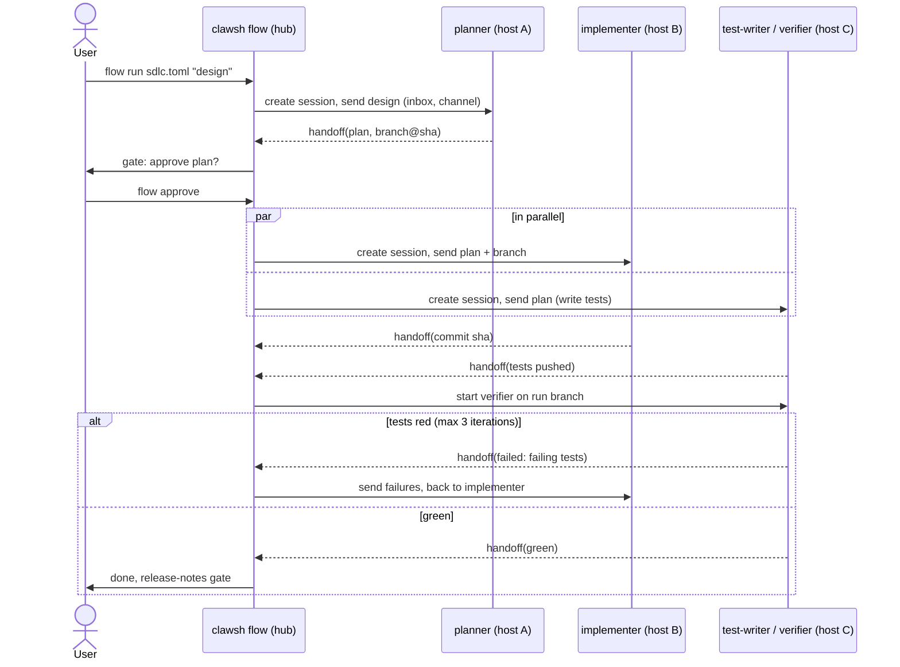

# Spike: cross-session orchestrator

Issue #74. How sessions on different machines message each other, and how one input drives a pipeline of coordinated sessions (plan on A, implement on B, test on C). This is a design doc; the PoC lives on the unmerged branch [`doc/74/orchestrator-spike-poc`](https://github.com/varogonz95/clawsh/tree/doc/74/orchestrator-spike-poc) (see [section 11](#11-poc-what-was-proven)). No product code is in this PR.

**Recommendation**

- **Delivery (primary):** Claude Code **channels**, pushed by `clawsh mcp`. The stub already runs inside every session, so it is the natural receiver. Messages queue in the *agent* (not the stub), so a session that is busy or restarting loses nothing.
- **Delivery (fallback):** **hooks** (`UserPromptSubmit` adds the inbox as context; `Stop` can block with the inbox as the reason to keep claude going). It needs no launch flag and no org setting, only the hook install from #35.
- **Result out:** an explicit **`handoff` MCP tool** call; `Stop.last_assistant_message` is the fallback summary.
- **Topology:** a **hub-side `clawsh flow` process** drives flows; agents stay dumb (queue + relay). Flow state is a file on the hub machine. Artifacts move through **git** (one branch per run); messages carry pointers and summaries, never code.
- **Build order:** `clawsh send` first (smallest useful primitive), then `handoff`, then `flow run`, then the web view.

Everything below assumes #33's states (`working` / `idle` / `needs_input`) exist; the orchestrator uses them to know a stage finished or is stuck.

## 1. Delivering a message into a session

Today only raw PTY bytes go in (`internal/agent/server.go`, `readClient`) and only scrollback comes out.

| | (a) Channels via `clawsh mcp` | (b) Hooks inbox | (c) PTY injection | (d) Headless `claude -p --resume` |
| --- | --- | --- | --- | --- |
| **How** | Stub declares `experimental["claude/channel"]`, emits `notifications/claude/channel`; claude shows `<channel source="clawsh" from=… message_id=…>` | `UserPromptSubmit` hook returns `additionalContext` from the inbox; `Stop` hook returns `decision:"block"` + reason to continue | Agent types the text + Enter into the PTY once `idle` | One `claude -p --resume <id>` process per stage turn |
| **Reliability** | High: events queue inside claude and are batched onto the next turn; the preview docs say delivery is not acknowledged, so clawsh keeps its own queue and removes on `reply`/`handoff` | Medium: `UserPromptSubmit` only fires when someone submits a prompt, so an idle session never sees the inbox; `Stop`-block fixes that only right after a turn ends | Low: races the user's typing, a permission dialog or a slash menu eats the text; needs exact `idle` knowledge | High per call, but no live session: loses the interactive TUI and the user can't watch or steer |
| **Idle detection** | Not needed to deliver; needed only by the orchestrator to time the *next* message (#33) | Implicit (hook fires at turn boundaries) | Required, and `needs_input` must block injection | Implicit (process exit) |
| **Managed sessions** | Yes (stub is in `.mcp.json`; `CLAWSH_SESSION_ID` identifies it) | Yes (needs #33/#35 hook install) | Yes only | Yes, but the agent must own the process |
| **External sessions** | Yes, if started with the flag and the plugin installed | Yes, if the global hooks are installed | No (agent doesn't own the PTY) | No |
| **Launch flags** | `--channels plugin:clawsh@clawsh` (approved list) or `--dangerously-load-development-channels` while the plugin isn't allowlisted; interactive sessions only (ignored with `-p`) | None | None | None |
| **Preview risk** | **High**: research preview, protocol "may change", Team/Enterprise orgs need `channelsEnabled` | Low: hooks are stable | Low | Low |
| **Windows** | Same as `clawsh mcp` today (untested; see `docs/poc-auto-agent.md`) | `clawsh hook` spawn cost (~22 ms Node-launcher floor measured in the pet-view spike) | ConPTY write works (attach already does it) | Works |

**Primary: (a).** It is the only option that works for an idle interactive session without guessing, keeps the TUI, and reuses a process we already ship. **Fallback: (b)**, because it is stable and flag-free, and degrades gracefully: a blocked `Stop` turns "the session is idle, nothing is delivered" into "claude continues with the message". (c) stays out of the product: an injected prompt is indistinguishable from the user typing it, so it also defeats the trust labelling in section 7. (d) is the right tool for *unattended* stages where nobody needs the TUI; keep it as a stage option (`mode = "headless"`), not as the delivery layer.

Because the agent owns the queue, (a) and (b) share one backend: `POST /v1/messages` → inbox → either the stub (poll) or the hook (`clawsh hook` fetches pending messages from the local agent). The PoC proves the (a) path.

## 2. Getting a result out

| Option | Verdict |
| --- | --- |
| **`handoff(summary, artifacts)` tool** on `clawsh mcp` | **Primary.** Structured, explicit, the model decides when a stage is done, works with any state hooks. Needs `capabilities.tools`, which also gives the `reply` tool channels recommend. |
| `Stop.last_assistant_message` (hook) | **Fallback** when the model never called `handoff`: take the last message as the summary and mark the stage `done?` for the human gate. Free, but unstructured and fires after *every* turn, so it can't tell "finished" from "asked a question". |
| Marker in output (e.g. `HANDOFF:`) | Rejected: scrapes the PTY, collides with real output, breaks under redraws. |

A stage's role prompt ends with: "When done, call `handoff` with a summary and the branch/commit." The orchestrator treats `handoff` as the only reliable completion signal and `Stop` + `idle` for longer than `stall_after` as a stall (section 6).

## 3. Routing and topology

```
session ──(MCP tool)──▶ its agent ──▶ hub (clawsh flow) ──▶ target agent ──(inbox)──▶ target session
```

- **Hub-mediated, not agent-to-agent.** Agents only know their own sessions and have no map of other hosts; `hosts.toml` (tokens included) lives with the hub. Agent-to-agent would need every agent to hold every token. Cost: the flow only runs while the hub process runs.
- **Who is the hub.** A session's `handoff` posts to its *own* agent (`POST /v1/handoffs`), which cannot reach other machines. So the orchestrator **polls** agents it has runs on (`GET /v1/handoffs?since=`, plus the hook-driven `Status`). Polling over the existing overview loop (`internal/hub`, `internal/web/events.go`) avoids new inbound connectivity: agents already must be reachable from the hub, not from each other.
- **Where the orchestrator runs.** A new **`clawsh flow`** command (long-lived, in a terminal or as a service next to `clawsh web`), with `clawsh web` showing its state read-only through the same state file. Not inside an agent: an agent restart (sessions die with it) must not kill the control plane; and not inside `clawsh web`: that is a loopback UI that may not be running.
- **When it isn't running.** Sessions keep working and `handoff` calls queue in their agents (bounded; see 429 in the PoC). On restart, `clawsh flow` reloads its state file and drains the agents' handoff queues, so no completion is lost. Nothing advances meanwhile; that is accepted.
- **Addressing.** Ad hoc: `host/idprefix`, as for every hub command. Inside a flow: **role names** (`planner`, `implementer`, `tester`) bound to a `host/id` at stage start, so a restarted stage keeps its role address.

## 4. Pipeline model

`flow.toml`, one file per flow, stored wherever the user likes (`clawsh flow run ./sdlc.toml`). Concepts:

- `[[stage]]` with `name` (the role address), `host`, `dir`, `role` (system-prompt text), `permission_mode`, optional `mode = "headless"`.
- `needs = ["a", "b"]` edges: a stage starts when all its needs are done. Stages without a shared need run in parallel.
- `gate = "human"` pauses before a stage starts (or `after`, before the result is forwarded) until `clawsh flow approve`.
- `loop`: `on_fail = "implement"`, `max_iterations = 3` sends the failing stage's handoff back to an earlier stage, then re-runs forward; exceeding the cap stops the flow in `blocked` and notifies.
- `[input]`: the single channel the user types into: `clawsh flow run sdlc.toml "build X"`, or `clawsh flow say <run> "…"` later. The text becomes the first stage's initial message.

The full SW-lifecycle example (design by the user, plan on A, implement on B, tests on C in parallel with and after implementation):

```toml
# sdlc.toml
name = "sdlc"
max_hops = 12              # total messages in a run
max_cost_usd = 20          # soft cap, see section 7
git_remote = "git@github.com:acme/app.git"
base_branch = "main"       # a run branch flow/<run-id> is created from it

[input]
prompt = "The user's design, as typed into `clawsh flow run`."
to = "planner"

[[stage]]
name = "planner"
host = "workstation"
dir = "~/src/app"
permission_mode = "plan"
role = """
Turn the design into a numbered list of features, each with acceptance tests.
Write them to docs/features.md on the run branch, commit and push, then call handoff.
"""

[[stage]]
name = "implementer"
host = "buildbox"
dir = "~/src/app"
needs = ["planner"]
permission_mode = "acceptEdits"
role = """
Implement the features in docs/features.md on the run branch. Commit and push per feature.
When all are done, call handoff with the commit sha.
"""
gate = "human"             # approve the plan before code is written

[[stage]]
name = "test-writer"       # parallel with implementer: writes tests from the plan only
host = "testbox"
dir = "~/src/app"
needs = ["planner"]
permission_mode = "acceptEdits"
role = "Write failing tests for docs/features.md, push to the run branch, then call handoff."

[[stage]]
name = "verifier"          # after both
host = "testbox"
dir = "~/src/app"
needs = ["implementer", "test-writer"]
permission_mode = "default"
role = """
Pull the run branch, run the full test suite. If green, call handoff(summary="green").
If red, call handoff(summary="red: <failing tests>", status="failed").
"""
[stage.loop]
on_fail = "implementer"    # failing handoff goes back with the failures attached
max_iterations = 3

[[stage]]
name = "release-notes"
host = "workstation"
dir = "~/src/app"
needs = ["verifier"]
gate = "human"
permission_mode = "default"
role = "Summarise the run branch diff as release notes. Do not push."
```

Sequence for the SW-lifecycle example (GitHub renders the Mermaid block):



## 5. Handing off artifacts between machines

| Mechanism | Use |
| --- | --- |
| **Git, one branch per run** (`flow/<run-id>`) | **Code, docs and tests.** Every machine already needs the repo; history, review and rollback are free. Each stage checks out the run branch, commits, pushes; `handoff` carries the sha. |
| Messages | Summaries, decisions, failure lists, pointers (branch, sha, file paths). Capped (e.g. 16 KiB) so nobody pastes a codebase through the queue. |
| #21 transfer modes | Not the default. Useful when a host has no git remote access or the work isn't committed (uncommitted workspace, build outputs). A flow stage may set `transfer = "archive"` once #21 exists. |

Each stage needs: the repo cloned at `dir`, git credentials for the remote on that host (not clawsh's job), and the run branch fetched. The orchestrator makes the first message of each stage say which branch and sha to start from; a stage that can't push (`git push` fails) calls `handoff(status="failed")`.

## 6. State and durability

- **Where.** `<config dir>/clawsh/flows/<run-id>.json` on the hub machine: per stage `state` (`pending`, `starting`, `running`, `waiting_gate`, `done`, `failed`, `blocked`), bound `host/id`, iteration count, last handoff, message log (ids, from/to, size, time; content truncated). Written atomically on every transition.
- **Agent restart.** Sessions die with it. The flow sees `gone` from the overview, marks the stage `failed(agent_restarted)`, and offers `clawsh flow retry <run> <stage>`: a new session with the same role prompt plus the run branch and last handoff, so state lives in git and the file, not in the dead session.
- **Stage crash** (`exited` with non-zero code): same as above. **Stall** (`idle`, no handoff, longer than `stall_after`, default 15 min): nudge once with a message ("call handoff when done, or say what blocks you"), then mark `blocked` and notify.
- **`needs_input`** (#33): the stage goes `waiting_user`; `flow ls` and the web view show it, and the user answers by attaching (`clawsh attach host/id`) or `clawsh send`. It does not count against the stall timer.
- **Orchestrator crash.** Reload the state file; re-attach to sessions by `host/id` (still alive unless their agent restarted); drain handoff queues. Duplicate delivery is avoided by message ids.

## 7. Safety

- **Cross-session prompt injection.** A message from another session is untrusted input, exactly like a webhook. (1) The channel `instructions` say so, and the tag always carries `from` and `message_id`, set by the stub (a sender can't override them; PoC test). (2) Only the *orchestrator* may post to a flow stage, so stage-to-stage content is mediated and size-capped. (3) Permission modes stay as the user set them; `bypassPermissions` is never a default for a stage. (4) Don't relay permission prompts to other sessions: channels' permission relay needs an authenticated human sender, and a session is not one. (5) Ad hoc `clawsh send` requires the same bearer token as every other endpoint.
- **Permission modes per stage.** `permission_mode` is passed as a `claude` arg at launch (`--permission-mode`), so the planner can be read-only (`plan`) while the implementer gets `acceptEdits`. The set of allowed modes is validated by the hub; unknown modes fail the flow before anything starts.
- **Limits.** `max_hops` per run, `max_iterations` per loop, per-stage `timeout`, a global concurrent-stages cap. Cost/rate: clawsh can't see tokens directly; use `max_hops` and stage timeouts as the budget, and read usage from the transcript path hooks provide (#33) if a hard dollar cap is wanted (open question).
- **Kill switch.** `clawsh flow stop <run>` kills every stage session (`DELETE /v1/sessions/{id}`) and marks the run `stopped`; one Ctrl-C on `clawsh flow` does the same after a prompt.
- **CLAUDE.md rules intact.** Stages are created through the existing `POST /v1/sessions` with `Args` only; the executable stays fixed by `clawsh agent --claude` and no new field carries a command. Messages are data written to an inbox, never executed. Slow consumers: the inbox is bounded and refuses (429) instead of blocking a session. One WebSocket writer is unaffected (no new sockets).

## 8. UX

CLI:

```
clawsh send <host/id> <message>        # ad hoc; --from label, stdin with -
clawsh inbox <host/id>                 # pending (undelivered) messages
clawsh flow run <flow.toml> [input]    # prints the run id
clawsh flow ls                         # runs and stage states
clawsh flow say <run> <message>        # more input to the running flow
clawsh flow approve <run> [stage]      # pass a human gate
clawsh flow retry <run> <stage>
clawsh flow stop <run>
```

Web UI: a **Flows** route with one lane per stage (host, state, last handoff), edges drawn between lanes, gate buttons, and a message log. It reads the flow state file through `clawsh web` and reuses the overview SSE for session states. It sits next to the sidebar from #69 (a stage opens its terminal like any session) and the pet view of #72 (stage pets can show hand-off bubbles from the same event feed). #70 is the natural home for the lane layout once it exists.

## 9. Compared with agent teams, subagents and Managed Agents

| | Agent teams | Subagents | Managed Agents API | clawsh flows |
| --- | --- | --- | --- | --- |
| Where it runs | One machine, one lead session (experimental) | Inside one session | Anthropic-hosted sandboxes | The user's own machines |
| Isolation | Shared checkout / worktrees | Shared context | Cloud container | Separate machine, repo, credentials |
| User sees/steers | Lead session | Summaries | API/console | Every stage is a real attachable `claude` TUI |
| Auth/cost | The user's Claude Code | Same | API billing | The user's own logged-in sessions |

What only clawsh does: coordinate **real interactive sessions on several of the user's own machines** (different OS, GPUs, secrets that never leave the host), keep each one attachable from a phone, and run a human-gated pipeline across them. Everything else (a single-machine fan-out, a hosted batch) is better served by agent teams or the API; the doc should say so and not compete.

## 10. Risks and open questions for a human

1. **Channels are a research preview** with a changing protocol, a launch flag, and an org setting. Is that acceptable for the primary path, given the hooks fallback? Decision: ship (a) behind `clawsh mcp --channel` and keep (b) as the default until channels reach GA.
2. **Plugin allowlist.** `clawsh` is not on the approved channel allowlist; users need `--dangerously-load-development-channels` (interactive prompt on every launch). Should clawsh apply for allowlisting, and should a managed session pass the flag itself on launch? (Passing it silently skips a safety dialog the user may expect.)
3. **Cost cap.** Worth parsing transcripts for a dollar cap, or are hops/timeouts enough?
4. **Who may message whom.** Is bearer-token possession on the target agent enough, or should flows have a per-run token scoped to its stages?
5. **Mixed-OS hosts.** Windows `clawsh mcp` and `clawsh hook` are unmeasured; the flow format has no per-OS role differences.
6. **External sessions** can receive channel events only if started with the flag; the plugin could print the exact launch line, but cannot enforce it.
7. **Git as the artifact bus** assumes a shared remote; air-gapped hosts need #21's archive mode first.

## 11. PoC: what was proven

Branch [`doc/74/orchestrator-spike-poc`](https://github.com/varogonz95/clawsh/tree/doc/74/orchestrator-spike-poc), README in `docs/spikes/orchestrator-poc/`. `go test -race ./internal/mcp/... ./internal/agent/...` passes there.

- **Proven (scripted MCP client, real agent server):** `clawsh mcp --channel` declares the `claude/channel` capability; `POST /v1/messages` for session B is queued by the agent and long-polled by B's stub; it leaves the stub as a `notifications/claude/channel` line with `content` and `meta`; invalid meta keys are dropped and `from`/`message_id` can't be spoofed; unknown targets get 404.
- **Not proven:** that a real, logged-in `claude` renders and acts on the event (needs the manual check in the issue: two sessions started with the development-channels flag; `channelsEnabled` on Team/Enterprise), the reply/`handoff` tools, cross-machine routing, durability across restarts, Windows.

## 12. Draft `internal/api` types and endpoints

Per `CLAUDE.md`, types go in `internal/api` first, then e2e tests. `Message`/`SendRequest` exist in the PoC; the rest are drafts.

```go
// Message is a note for a session. Content is untrusted input from another session.
type Message struct {
	ID      string            `json:"id"`
	To      string            `json:"to"`             // session id on this agent (managed or external)
	From    string            `json:"from,omitempty"` // label set by the sender's stub or the hub
	Content string            `json:"content"`        // capped (16 KiB)
	Meta    map[string]string `json:"meta,omitempty"` // identifier keys only
	Time    time.Time         `json:"time"`
}

type SendRequest struct { To, From, Content string; Meta map[string]string }

// Handoff is a stage's result, posted by the session's stub via the `handoff` tool.
type Handoff struct {
	ID        string    `json:"id"`
	Session   string    `json:"session"`            // the posting session
	RunID     string    `json:"run_id,omitempty"`   // from CLAWSH_RUN_ID in the session env
	Stage     string    `json:"stage,omitempty"`    // from CLAWSH_STAGE
	Status    string    `json:"status"`             // "done" (default) | "failed" | "needs_input"
	Summary   string    `json:"summary"`
	Artifacts []Artifact `json:"artifacts,omitempty"`
	Time      time.Time `json:"time"`
}

type Artifact struct {
	Kind string `json:"kind"` // "git" | "file" | "url"
	Ref  string `json:"ref"`  // branch@sha, path, or URL
}
```

| Endpoint | Purpose |
| --- | --- |
| `POST /v1/messages` | Queue a `SendRequest` for a known session (202 + `Message`; 404 unknown, 429 full) |
| `GET /v1/inbox/{id}?wait=` | Long-poll and drain a session's queue (stub or `clawsh hook`) |
| `POST /v1/handoffs` | A session's stub posts a `Handoff` (from the `handoff` tool) |
| `GET /v1/handoffs?since=` | The orchestrator drains handoffs, per agent |
| `POST /v1/sessions` (existing) | Gains env only via `CreateRequest.Env` for `CLAWSH_RUN_ID`/`CLAWSH_STAGE` (allowlisted keys, never the executable) |

## 13. Follow-up issue outlines

Format per `docs/issue-refinement.md`; each is one PR. Not filed.

### A. `clawsh send` and the inbox (smallest primitive)

- **Goal:** `clawsh send host/idprefix "text"` delivers text to another session as a channel event.
- **Scope in:** `api.Message`/`SendRequest`; agent `POST /v1/messages`, `GET /v1/inbox/{id}` (bounded, in memory); `hub.Client.Send/Inbox`; `clawsh send`, `clawsh inbox`; `clawsh mcp --channel` (poll + `notifications/claude/channel`); plugin docs for the launch flag. **Out:** handoff, flows, hooks fallback, web UI.
- **Decisions:** paths above; 16 KiB content cap; 100 queued per target; meta keys filtered to identifiers; stub-set `from`/`message_id` win.
- **Acceptance:** e2e test posts to a managed `/bin/sh` session and reads it back from the inbox; mcp test from the PoC; `make vet`, `make test`; wiki Protocol and Commands updated. **Manual:** two real sessions with the development-channels flag (and `channelsEnabled`); A sends, B reacts.
- **Dependencies:** none (channels research preview risk noted).

### B. Hook-based inbox delivery (fallback)

- **Goal:** sessions without the channel flag still receive messages.
- **Scope:** `clawsh hook UserPromptSubmit|Stop` fetches pending messages from the local agent and returns `additionalContext` / a block reason; messages are removed on delivery. **Out:** hook install (#35).
- **Acceptance:** `TestHookDeliversInbox` (hook subprocess against a real agent); empty inbox returns nothing and exits 0.
- **Dependencies:** A, #33 (hook ingest), #35 (global hook install).

### C. `handoff` and `reply` MCP tools

- **Goal:** a session reports a result and replies to a sender, structured.
- **Scope:** `capabilities.tools` on `clawsh mcp`; tools `handoff(summary, status, artifacts)`, `reply(message_id, text)`, `sessions()`; `api.Handoff`; `POST/GET /v1/handoffs`; `Stop.last_assistant_message` as fallback summary when #33 reports `idle` with no handoff. **Out:** flows.
- **Acceptance:** scripted MCP client calls each tool against a real agent; handoff visible via `GET /v1/handoffs`; `reply` lands in the sender's inbox.
- **Dependencies:** A, #33.

### D. `clawsh flow run|ls|stop|approve|retry` (core engine)

- **Goal:** run a `flow.toml` of stages with needs, parallelism, human gates, loops with caps; state in a file; resumable.
- **Scope:** TOML schema (as in section 4) and validation; scheduler; git run branch creation; state file; `max_hops`, `timeout`, `stall_after`; kill switch. **Out:** web UI, transfer modes, cost caps.
- **Acceptance:** a Go test runs the sdlc example against 3 fake agents (`/bin/sh` stand-ins posting handoffs); loop cap blocks the run; restart of the engine resumes; gate waits for `approve`.
- **Dependencies:** A, C, #33, #21 optional.

### E. Flows view in the web UI

- **Goal:** pipeline lanes, gate buttons, message log in `clawsh web`.
- **Scope:** read-only API over the flow state, `#/flows` route, approve/stop buttons. **Out:** editing flows.
- **Acceptance:** `TestFlowsEndpoints`; Playwright manual run of the sdlc example.
- **Dependencies:** D, #69; #70/#72 for layout and bubbles.
